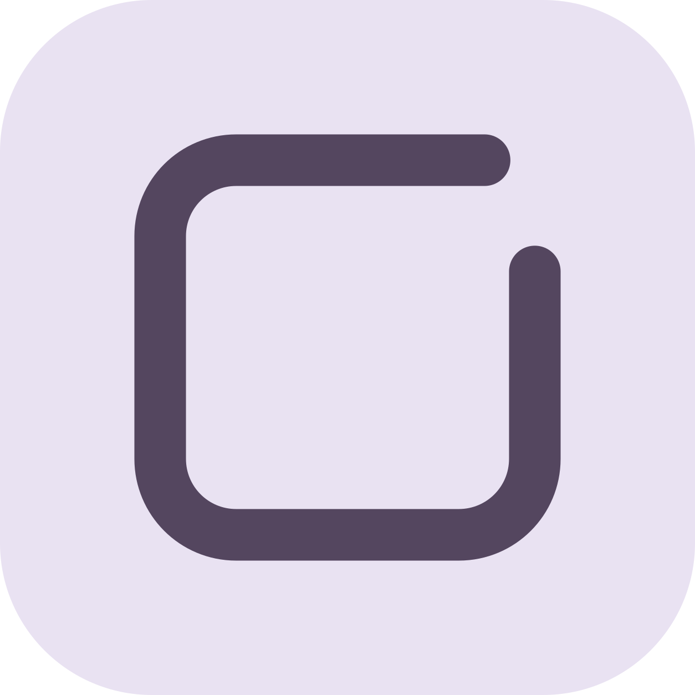
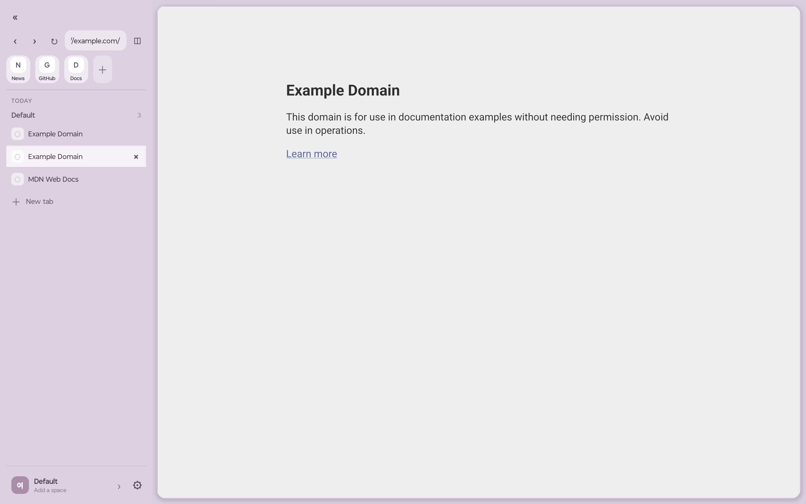
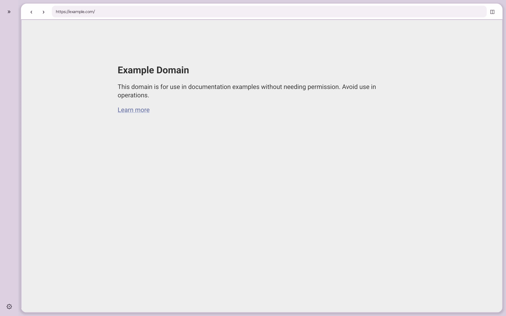
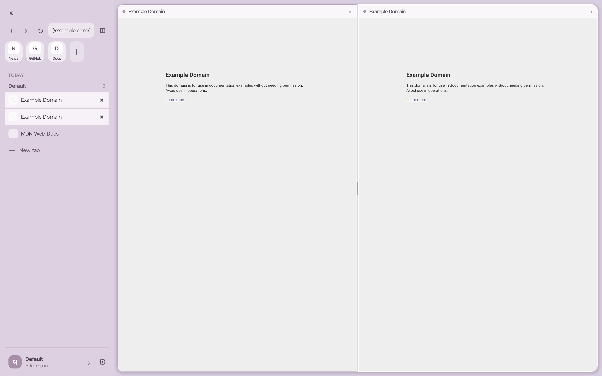

[English](README.md)

<p align="center">
  
</p>

<h1 align="center">여유 · Yeoyu</h1>

<p align="center">
  넓은 화면과 키보드 중심 탐색을 실험하는 Android 태블릿 브라우저입니다.<br>
  React Native chrome, GeckoView 페이지, generated JSI 뒤의 Rust 도메인 코어를 결합합니다.
</p>

<p align="center">
  <a href="https://github.com/loopy-lim/yeoyu/actions/workflows/check.yml"></a>
  <a href="https://github.com/loopy-lim/yeoyu/actions/workflows/android.yml"></a>
</p>



> [!WARNING]
> 여유는 제품 출시본이나 보안 감사를 마친 브라우저가 아닌 POC입니다. 배포 파일과 검증 범위는 [GitHub Releases](https://github.com/loopy-lim/yeoyu/releases)에서 확인하세요. 시험하기 전에 중요한 브라우징 데이터를 백업하세요.

## 왜 여유인가

여유는 Space·분할·단축키가 **태블릿에 먼저** 맞게 설계된 브라우저가 어떤 느낌인지 실험합니다. 폰용 chrome에 기능을 얹는 방식이 아닙니다.

제품의 축은 세 가지입니다.

1. **머무를 수 있는 Space** — 모든 Space에서 보이는 Favorite, Space별 pinned tab, 폴더·북마크·방문 기록·빠른 열기로 맥락을 잃지 않고 탐색을 정리합니다.
2. **손과 키보드를 함께** — 펼치고 접는 사이드바, 가로·세로 분할, 터치 드래그, 마우스 메뉴, 편집 가능한 단축키를 가로 태블릿에 맞춥니다.
3. **상태를 로컬에서 소유** — workspace·tab·bookmark·keymap 규칙은 Rust가, 화면은 React Native가 담당합니다. Android는 실제 GeckoView 세션과 권한·다운로드·PIP·창·호환 Mozilla 확장을 유지합니다.

비공개 탭, 추적 보호, 범위를 제한한 가져오기·내보내기 같은 프라이버시 실험은 의도적으로 좁게 둡니다. 범위는 [프로젝트 상태](docs/project-status.ko.md)를 보세요.

<p>
  
  
</p>

## 구조

```text
React Native UI
      │
BrowserController와 typed port
      ├──────── Android native layer ─────── GeckoView session
      │
      └──────── generated JSI bridge ────── Rust domain core
                                              │
                                        검증된 snapshot
```

엔진과 저장 가능한 브라우저 모델을 의도적으로 분리했습니다. Android가 실제 `GeckoSession`을, Rust가 직렬화 가능한 ID와 상태 전이를 소유합니다. 자세한 경계는 [아키텍처](docs/architecture.ko.md).

## 빠른 시작

**필요:** Android 8+ (가로 태블릿), Node.js 26, Bun 1.4.3, `aarch64-linux-android`가 있는 Rust 1.99.0, JDK 17+, Android SDK 37.1 / Build Tools 37.0.0 / NDK 27.1.12297006, `cargo-ndk` 4.1.2. 버전은 `.node-version`, `.bun-version`, `rust-toolchain.toml`에 고정되어 있습니다.

```sh
rustup target add aarch64-linux-android
cargo install cargo-ndk --version 4.1.2 --locked
./scripts/bootstrap.sh
./scripts/check.sh
./scripts/build-android.sh Debug
bun start
```

`bootstrap.sh`는 고정된 [Rustra](https://github.com/loopy-lim/rustra) 소스를 무시 경로 `.deps/`에 받고, 의존성을 설치한 뒤 generated binding을 검증합니다. 기본 ABI는 `arm64-v8a`입니다.

기기 설치·빌드 프로필·환경 변수·전체 검증은 [개발 가이드](docs/development.ko.md).

## 구성

| 경로 | 역할 |
| --- | --- |
| `src/` | React Native chrome, controller, policy, UI 상태 |
| `native/` | Rust workspace / tab / bookmark 도메인과 snapshot 검증 |
| `android/` | GeckoView surface, session, Android 연동, 앱 shell |
| `modules/rustra-jsi/` | generated Rust ↔ React Native bridge |
| `generated/` | generated TypeScript contract·codec |
| `tests/` | policy·UI·controller·acceptance helper |
| `docs/` | 아키텍처·개발·프로젝트 상태 |

## 검증

```sh
./scripts/check.sh
```

Host gate는 Rust format/test/Clippy, Bun test, Python check, layout geometry, contrast, TypeScript, generated-code consistency를 돌립니다. Android unit test와 서명 테스트 APK는 CI에서 따로 확인합니다. 빌드 성공을 실기기 acceptance나 공개 release로 보지 않습니다 — [프로젝트 상태](docs/project-status.ko.md).

## 문서

[안내](docs/README.ko.md) · [아키텍처](docs/architecture.ko.md) · [개발](docs/development.ko.md) · [상태](docs/project-status.ko.md) · [기여](CONTRIBUTING.md) · [보안](SECURITY.md)

## 상태와 라이선스

지금은 Android POC만 실행됩니다. iOS browser-surface interface는 있지만 실행 가능한 iOS 앱은 없습니다. 동기화, 저장되는 split group, 분리된 계정 profile, 자동 archive는 없습니다. 확장은 호환 Mozilla 부가기능만 대상이며 Chrome CRX나 모든 Firefox API는 지원하지 않습니다.

공간 중심 브라우징에서 영감을 받았지만 The Browser Company, Arc, Mozilla, Google과 제휴·승인 관계가 아닙니다. 외부 구성요소의 라이선스·상표는 각 권리자에게 있습니다.

[Apache License 2.0](LICENSE)으로 배포합니다.
