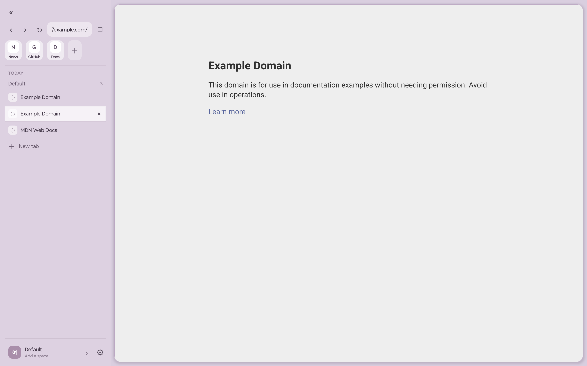
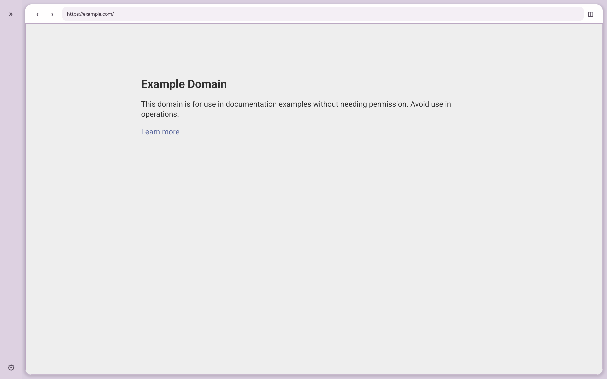
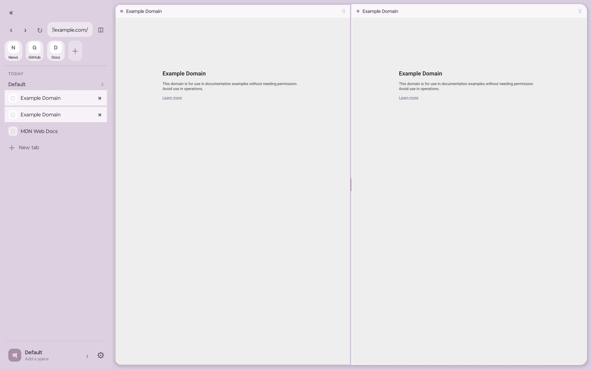

[한국어](README.ko.md)

<p align="center">
  
</p>

<h1 align="center">Yeoyu</h1>

<p align="center">
  An experimental Android tablet browser for spacious, keyboard-friendly browsing.<br>
  React Native chrome, GeckoView pages, and a Rust domain core behind generated JSI bindings.
</p>

<p align="center">
  <a href="https://github.com/loopy-lim/yeoyu/actions/workflows/check.yml"></a>
  <a href="https://github.com/loopy-lim/yeoyu/actions/workflows/android.yml"></a>
</p>



> [!WARNING]
> Yeoyu is a proof of concept, not a production-ready or security-audited browser. Check [GitHub Releases](https://github.com/loopy-lim/yeoyu/releases) for builds and their validation scope. Back up important browsing data before experimenting.

## Why Yeoyu

Yeoyu explores what a **tablet-first** browser feels like when Space, split view, and shortcuts are first-class — not bolted onto a phone chrome.

Three ideas shape the product:

1. **Spaces you can stay in** — Favorites across Spaces, per-Space pinned tabs, folders, bookmarks, history, and quick open, so navigation stays organized without losing context.
2. **Hands and keyboard together** — Expandable sidebar, horizontal and vertical splits, touch drag and drop, mouse menus, and editable shortcuts aimed at landscape tablets.
3. **Local ownership of state** — Workspace, tab, bookmark, and keymap rules live in Rust; React Native owns presentation. Android keeps live GeckoView sessions, permissions, downloads, PiP, windows, and compatible Mozilla extensions.

Privacy experiments (private tabs, tracking protection, bounded import/export) stay intentional and limited. See [Project status](docs/project-status.md) for what is in and what is not.

<p>
  
  
</p>

## Architecture

```text
React Native UI
      │
BrowserController and typed ports
      ├──────── Android native layer ─────── GeckoView sessions
      │
      └──────── generated JSI bridge ────── Rust domain core
                                              │
                                      validated snapshots
```

The engine and the durable browser model stay separate on purpose. Android owns live `GeckoSession` objects; Rust owns serializable identities and state transitions. Details: [Architecture](docs/architecture.md).

## Quick start

**Needs:** Android 8+ (landscape tablets), Node.js 26, Bun 1.4.3, Rust 1.99.0 with `aarch64-linux-android`, JDK 17+, Android SDK 37.1 / Build Tools 37.0.0 / NDK 27.1.12297006, and `cargo-ndk` 4.1.2. Versions are pinned in `.node-version`, `.bun-version`, and `rust-toolchain.toml`.

```sh
rustup target add aarch64-linux-android
cargo install cargo-ndk --version 4.1.2 --locked
./scripts/bootstrap.sh
./scripts/check.sh
./scripts/build-android.sh Debug
bun start
```

`bootstrap.sh` pulls the pinned [Rustra](https://github.com/loopy-lim/rustra) source into ignored `.deps/`, installs deps, and verifies generated bindings. Default ABI: `arm64-v8a`.

Device install, build profiles, env vars, and the full verification flow: [Development](docs/development.md).

## Layout

| Path | Role |
| --- | --- |
| `src/` | React Native chrome, controllers, policies, UI state |
| `native/` | Rust workspace / tab / bookmark domain and snapshot validation |
| `android/` | GeckoView surfaces, sessions, Android integrations, app shell |
| `modules/rustra-jsi/` | Generated Rust ↔ React Native bridge |
| `generated/` | Generated TypeScript contracts and codecs |
| `tests/` | Policy, UI, controller, and acceptance helpers |
| `docs/` | Architecture, development, and project status |

## Verify

```sh
./scripts/check.sh
```

Host gate: Rust format/tests/Clippy, Bun tests, Python checks, layout geometry, contrast, TypeScript, generated-code consistency. Android unit tests and a signed test APK run separately in CI. A green build is not device acceptance or a public release — see [Project status](docs/project-status.md).

## Docs

[Index](docs/README.md) · [Architecture](docs/architecture.md) · [Development](docs/development.md) · [Status](docs/project-status.md) · [Contributing](CONTRIBUTING.md) · [Security](SECURITY.md)

## Status and license

Android-only proof of concept today. An iOS browser-surface interface exists, but there is no runnable iOS app. Sync, saved split groups, isolated account profiles, and automatic archiving are not implemented. Extensions target compatible Mozilla add-ons — not Chrome CRX or every Firefox API.

Inspired by spatial browser workflows; not affiliated with The Browser Company, Arc, Mozilla, or Google. Third-party components keep their own licenses and trademarks.

Licensed under the [Apache License 2.0](LICENSE).
